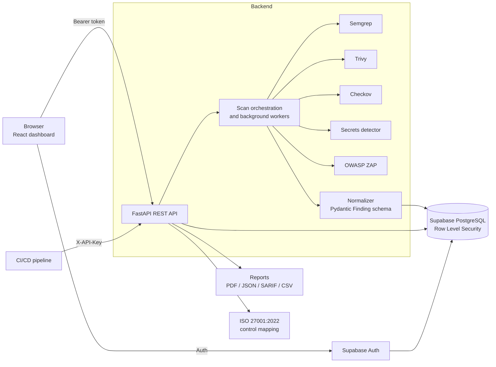

# SecureFlow

**A full-stack application security platform that runs five scanners behind one REST API and one dashboard.**

SecureFlow scans source code, dependencies, containers, infrastructure-as-code and running web apps, then normalizes every result into a single finding model. Findings can be deduplicated across engines, triaged through a lifecycle, mapped to ISO/IEC 27001:2022 controls, exported as reports, and used to pass or fail a CI/CD pipeline.

<!-- Add badges once CI is set up, for example:

-->

<!-- Add a hero screenshot:  -->

## Highlights

| | |
|---|---|
| **5 scanners** | Semgrep (SAST), Trivy (SCA and containers), Checkov (IaC), a custom entropy-based secrets detector, OWASP ZAP (DAST) |
| **1 unified schema** | Every scanner output is normalized into one Pydantic `Finding` model with 40+ fields (severity, CWE, CVE, remediation guidance, and more) |
| **3 source integrations** | GitHub, GitLab, Bitbucket |
| **3 sign-in methods** | Email/password, Google, GitHub (Supabase Auth) |
| **4 export formats** | PDF, JSON, SARIF 2.1.0, CSV |
| **CI/CD gate** | `POST /api/gate/evaluate` returns a pass/fail decision for pipelines |
| **Per-user data isolation** | Supabase PostgreSQL with Row Level Security on projects, scans and findings |

## Features

### Scanning
- **SAST** with Semgrep, **SCA and container scanning** with Trivy, **IaC scanning** with Checkov.
- **Secrets detection** using a custom entropy-based detector.
- **DAST** with OWASP ZAP, run as an asynchronous background job with real-time progress reporting, so long scans never block dashboard requests. Target URLs are validated to prevent SSRF, and a strength selector (`LOW`, `MEDIUM`, `HIGH`, `INSANE`, default `MEDIUM`) controls how aggressive the attack is.
- **Scan sources:** connect a GitHub, GitLab or Bitbucket repository, or upload a ZIP.

### Findings management
- **Cross-engine deduplication:** the same issue reported by several scanners is linked to one canonical record through `duplicate_of`, and no data is overwritten.
- **Finding lifecycle:** `Open`, `Triaged`, `Fixed`, `Accepted`, with owner and notes fields, updated through `PATCH /api/findings/{id}`.
- **Triage panel** with status badges and duplicate indicators in the dashboard.

### Compliance and reporting
- **ISO/IEC 27001:2022 Annex A** control mapping (`backend/mappings/iso27001.py`), shared by reports and dashboards.
- **Compliance scoring** excludes duplicates and resolved findings (`Fixed`, `Accepted`). It reports `assessed: false` instead of a misleading 100% when nothing has been scanned yet.
- **Reports** in PDF (ReportLab), JSON, SARIF 2.1.0 and CSV.

### CI/CD integration
- Authenticate with **`X-API-Key`** (organization-scoped keys, with fallback to legacy per-user keys) or a Supabase **Bearer** token.
- **Decision gate** endpoint `/api/gate/evaluate` for automated pass/fail checks.
- A **Pipeline** dashboard page (`/dashboard/pipeline`) with copy-ready CI snippets.
- **SARIF 2.1.0** export for code-scanning tools.

## Architecture



**Design notes**
- The REST backend is decoupled from the frontend, and scanners are isolated behind a common runner and normalizer interface, so a new scanner means writing one adapter.
- Every core table carries a `user_id` and is protected by Row Level Security.
- Scans run in background workers. The API stays responsive while scans are running.

## Tech stack

| Layer | Technology |
|---|---|
| Backend | Python, FastAPI, Pydantic, ReportLab |
| Frontend | React, Vite, TanStack Router, shadcn/ui, Tailwind CSS |
| Database and auth | Supabase (PostgreSQL, Row Level Security, Supabase Auth) |
| Scanners | Semgrep, Trivy, Checkov, OWASP ZAP, custom secrets detector |
| Infrastructure | Docker, Docker Compose |

## Security by design

SecureFlow processes untrusted code and untrusted targets, so its own hardening matters:

- **ZIP upload safety:** zip-slip and path-traversal protection, long-path-safe extraction (Windows), and cleanup of temporary scan directories, including a startup sweeper for orphaned scan folders.
- **SSRF prevention** on DAST target URLs.
- **Row Level Security** so users can only read their own projects, scans and findings.
- **Secrets stay out of the repo:** environment files are git-ignored and only `.env.example` templates are committed.
- **Generic error messages** to clients, with upstream error details logged server-side only.

## Getting started

### Prerequisites
- Docker and Docker Compose
- A Supabase project (URL and keys for the backend and frontend)

### Run with Docker Compose

```bash
git clone https://github.com/BourrBo/secureflow.git
cd secureflow

# Copy the example environment files and fill in your own values
cp backend/.env.example backend/.env

docker compose up --build
```

Compose starts the backend, frontend, PostgreSQL, OWASP ZAP and Trivy. Check the exposed ports in `docker-compose.yml`, then confirm the backend is healthy at its `/health` endpoint.

> On PowerShell use `Copy-Item backend\.env.example backend\.env` instead of `cp`.

Never commit real `.env` files. They are already covered by `.gitignore`.

### API documentation
FastAPI serves interactive docs at `/docs` on the backend URL. Use them to explore endpoints and try requests.

## Using SecureFlow in CI/CD

1. Create an API key from the dashboard.
2. Open **Dashboard → Pipeline** and copy the snippet for your CI system.
3. Call the gate from your pipeline with the key in the `X-API-Key` header. The endpoint returns a pass or fail decision that your pipeline can act on:

```
POST /api/gate/evaluate
X-API-Key: <your-api-key>
```

Export SARIF 2.1.0 from a scan to surface findings in code-scanning tools.

## Project structure

```
secureflow/
├── backend/
│   ├── scanners/        # Scanner runners (Semgrep, Trivy, Checkov, secrets, ZAP)
│   ├── services/        # Auth, uploads, report generation, orchestration
│   ├── mappings/        # ISO/IEC 27001:2022 Annex A control mapping
│   └── ...
├── frontend/            # React + Vite dashboard
├── docker-compose.yml
└── README.md
```

## Roadmap

- Cloud deployment (Railway or a VPS)
- Additional scanners behind the existing adapter interface
- Automated end-to-end test suite in CI

## My role

I was the **lead integrator**: consolidating the scanner engines into the shared finding schema, the Supabase migration with Row Level Security, the asynchronous DAST pipeline, deduplication and the finding lifecycle, CI/CD integration (API keys, decision gate, SARIF), report generation, and Docker Compose deployment.

## Contributors

- **Shivam** ([@BourrBo](https://github.com/BourrBo)): lead integrator
- **Sujal**: SCA/Trivy module, GitHub/GitLab/Bitbucket OAuth integrations, organization and role-based access control
- **Vansh**: cross-engine deduplication design
- **Amit Kumar**: QA testing
